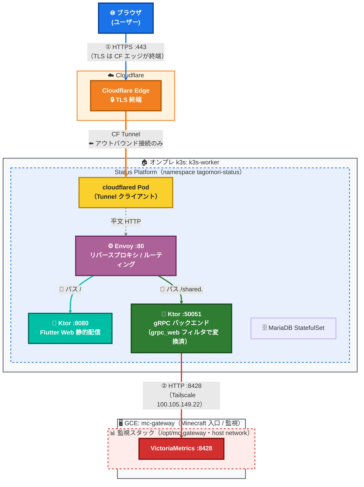
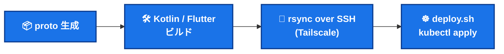

Proxmox 基盤の上に IaC（Terraform 等）で k3s を立て、既存 Minecraft 基盤に相乗りして本アプリ（Status Platform）を載せている。

<div align="center">

# 🖥️ Status Platform

**Minecraft サーバー監視ダッシュボード**

Flutter Web フロントエンド × Kotlin (Ktor / grpc-kotlin) バックエンド

[](frontend/)
[](backend/)
[](shared.proto)
[](deploy/envoy.yaml)
[](#1-cloudflare手動)
[](infra/terraform/)
[](#アーキテクチャ)
[](LICENSE)

🌐 公開 URL: **[https://app.tagomori.dev](https://app.tagomori.dev)**（Cloudflare Tunnel 経由・予定）

</div>

> [!NOTE]
> 既存インフラ [Minecraft-on-Kubernetes](https://github.com/Tagomori0211/Minecraft-on-Kubernetes) に相乗りする形で構築。
> 実行基盤のオンプレ k3s（`k3s-worker`）と、メトリクスソースの VictoriaMetrics（GCE `mc-gateway` 上）は同リポジトリが管理する**既存リソース**。

---

## 📑 目次

- [アーキテクチャ](#-アーキテクチャ)
- [リポジトリ構成](#-リポジトリ構成)
- [シークレットの取り扱い](#-シークレットの取り扱い)
- [初回セットアップ](#-初回セットアップ)
- [ローカル開発](#-ローカル開発)
- [動作確認（デプロイ後）](#-動作確認デプロイ後)
- [ライセンス](#-ライセンス)

---

## 🗺 アーキテクチャ



### 構成要素

| リソース | 役割 | 管理元 |
|---|---|---|
| 🏠 **k3s-worker**（オンプレ単一ノード k3s） | cloudflared + Envoy + Ktor + MariaDB を namespace `tagomori-status` で運用（マニフェストは `deploy/k8s/`） | 🔒 **既存リソース**（Minecraft-on-Kubernetes の `Ansible/`）。本リポジトリは CI でアプリを配置するのみ |
| 📊 **VictoriaMetrics**（GCE mc-gateway 上の :8428） | メトリクスソース | 🔒 **既存リソース**（Minecraft-on-Kubernetes の `gce/gateway/`）。本リポジトリでは触らない |
| 🔑 Secret skeleton（`tagomori-tunnel-token`）/ CI 用 SA / WIF | Tunnel トークンの保管（SA / WIF は旧 GCE デプロイ用で現在の CI は使わない） | ✅ 本リポジトリの Terraform（`infra/terraform/`） |

### ネットワーク / セキュリティ設計

- 🔐 Ktor → VictoriaMetrics は Tailscale 経由（mc-gateway の `100.105.149.22:8428`）。k3s の vmagent と同じ経路で、公開ポートは不要
- 📜 **TLS 証明書はサーバー側に一切不要**（Cloudflare が終端）
- 🚪 本アプリ用のインバウンドは開けない（80/443 不要）。CI は self-hosted ランナーから Tailscale 経由の SSH（CI 専用鍵）で k3s-worker に接続する

---

## 📂 リポジトリ構成

```
├── shared.proto                  # gRPC SSOT（MetricsService: GetMetrics / StreamMetrics）
├── frontend/                     # Flutter Web
│   └── lib/
│       ├── screens/status_screen.dart      # メインダッシュボード（30秒ポーリング）
│       ├── services/metrics_service.dart   # HTTP フォールバック（現行）
│       ├── services/metrics_grpc_service.dart  # gRPC-Web（スタブ生成後に有効化）
│       ├── models/ / widgets/ / theme/
│       └── src/generated/        # Dart スタブ出力先（CI生成・git管理外）
├── backend/                      # Kotlin / Ktor / grpc-kotlin
│   └── src/main/kotlin/app/
│       ├── Main.kt               # 1プロセス2ポート（:8080 静的配信 / :50051 gRPC）
│       └── SharedServiceImpl.kt  # VictoriaMetrics クエリ → gRPC レスポンス
├── deploy/
│   ├── k8s/                      # 本番: k3s マニフェスト + deploy.sh（k3s-worker 上で実行）
│   ├── docker-compose.yml        # ローカル用: cloudflared + Envoy + Ktor + MariaDB
│   ├── envoy.yaml                # gRPC-Web 変換 / パスルーティング（k3s では ConfigMap 化）
│   └── Dockerfile.api            # ローカル用: fat JAR を載せる薄いイメージ
├── infra/
│   ├── terraform/                # CI 用 SA / WIF・Secret skeleton（VM は持たない）
│   └── ansible/                  # 旧 tagomori-app 向けロール（未使用）
└── .github/workflows/deploy.yml  # CI/CD（SSH + rsync で k3s-worker へデプロイ）
```

---

## 🔑 シークレットの取り扱い

| シークレット | 保管場所 | 備考 |
|---|---|---|
| `TUNNEL_TOKEN` | 🗄️ Secret Manager: `tagomori-tunnel-token` → k8s Secret `cloudflared-token` | 初回に手動で作成。CI は作成・上書きしない |
| `DB_PASSWORD` / `PUBSUB_TOPIC` | 🐙 GitHub Secrets → k8s Secret `tagomori-status-db` | CI が毎回 stdin 経由で同期 |
| Pub/Sub 用 ADC | k8s Secret `gcp-credentials`（`minecraft/gcs-backup-credentials` の `key.json` を複製） | 初回に手動で作成。authorized_user 形式 |
| CI の SSH 鍵 | 🐙 GitHub Secrets: `K3S_SSH_KEY` / `K3S_KNOWN_HOSTS` | CI 専用鍵（コメント `sushiMCfront-ci-deploy`）。k3s-worker の `~shinari/.ssh/authorized_keys` に登録 |

> [!WARNING]
> **`.env` は絶対にコミットしない。** テンプレートは [.env.example](.env.example) を参照。

---

## 🚀 初回セットアップ

### 1. Cloudflare（手動）

1. **Zero Trust > Networks > Tunnels** で Tunnel 作成 → `TUNNEL_TOKEN` を控える
2. **Public Hostname** 追加: `app.tagomori.dev` → `http://envoy:80`（k8s Service 名で指定）

### 2. Terraform

```bash
cd infra/terraform
cp terraform.tfvars.example terraform.tfvars   # project_id を記入
terraform init && terraform apply
```

| 作成されるもの | 既存リソース（data source 参照のみ・変更しない） |
|---|---|
| `tagomori-tunnel-token` skeleton / CI 用 SA（`tagomori-ci-sa`）と IAM / WIF（`github-pool`） | `mc-proxy-sa`（mc-gateway の VM SA） |

### 3. シークレット登録

```bash
# Cloudflare で取得したトークンを登録
gcloud secrets versions add tagomori-tunnel-token --data-file=- <<< "eyJ..."

# k3s-worker 上で一度だけ実行（namespace は deploy/k8s/namespace.yaml）
sudo kubectl apply -f deploy/k8s/namespace.yaml
gcloud secrets versions access latest --secret=tagomori-tunnel-token \
  | sudo kubectl -n tagomori-status create secret generic cloudflared-token --from-file=TUNNEL_TOKEN=/dev/stdin
sudo kubectl -n minecraft get secret gcs-backup-credentials -o jsonpath='{.data.key\.json}' | base64 -d \
  | sudo kubectl -n tagomori-status create secret generic gcp-credentials --from-file=key.json=/dev/stdin
sudo mkdir -p /opt/tagomori-status/releases && sudo chown -R shinari: /opt/tagomori-status
```

### 4. GitHub Secrets

| Secret | 値 |
|---|---|
| `K3S_SSH_KEY` | k3s-worker（`shinari`）への CI 専用 SSH 秘密鍵 |
| `K3S_KNOWN_HOSTS` | `ssh-keyscan -t ed25519 100.107.122.45` の出力 |
| `DB_PASSWORD` | MariaDB の app ユーザーのパスワード（MariaDB 側は初回起動時にのみ設定される。変更時は `ALTER USER` も必要） |
| `PUBSUB_TOPIC` | 任意。`/list` トリガー用トピック（`projects/{project}/topics/{topic}` 形式） |
| `CF_API_TOKEN` / `CF_ZONE_ID` | 任意。デプロイ後の Cloudflare キャッシュ削除用（Zone:Cache Purge 権限のみ） |
| `GCP_WIF_PROVIDER` / `GCP_SERVICE_ACCOUNT` / `GCP_PROJECT_ID` | 任意。`infra/terraform` 変更時の Terraform ジョブ用 |

### 5. デプロイ

`main` にプッシュすると CI が以下を自動実行する:



---

## 💻 ローカル開発

```bash
# フロントエンド（HTTP フォールバックで動作。/api/metrics をモックするか CORS 許可が必要）
cd frontend && flutter pub get && flutter run -d chrome

# バックエンド（fat JAR ビルド。proto スタブは Gradle が自動生成）
cd backend && ./gradlew shadowJar

# Dart スタブ手動生成（gRPC-Web へ切り替える場合）
dart pub global activate protoc_plugin
protoc --proto_path=. --dart_out=grpc:frontend/lib/src/generated shared.proto

# envoy.yaml 構文検証
docker run --rm -v $(pwd)/deploy/envoy.yaml:/envoy.yaml envoyproxy/envoy:v1.31.5 --mode validate -c /envoy.yaml
```

---

## ✅ 動作確認（デプロイ後）

| # | 確認項目 | コマンド / 手順 | 期待結果 |
|---|---|---|---|
| 1 | 🌩️ Tunnel 接続 | （k3s-worker で）`sudo kubectl -n tagomori-status logs deploy/cloudflared` | `Registered tunnel connection` が出る |
| 2 | 📄 静的配信 | `curl -I https://app.tagomori.dev/` | `200` + `text/html`、`cf-ray` ヘッダ付きなら CF 経由 |
| 3 | 📊 VictoriaMetrics 到達 | （k3s-worker で）`curl -s http://100.105.149.22:8428/health` | `OK` |
| 4 | 📡 gRPC-Web ルーティング | ブラウザ DevTools > Network で `/shared.MetricsService/GetMetrics` を確認 | `Content-Type: application/grpc-web+proto` で `200` |

---

## 📜 ライセンス

[MIT License](LICENSE)